# CustomAssetLoader

Allows the loading of your own custom bundles completely independent from anything in game (unlike Motions)

**What can currently be replaced/added?**

- Gameobjects
- Sprites
- BattleEffectLists
- FMOD banks
- Timeline wav/ogg on Unity Audio Tracks, without FMOD Studio
- Shaders

**How do I utilize this in my mod?**

All bundles must reside within a mod's `custom_bundles` folder.

Alongside this, each bundle must come with a `asset_manifest.json` file, which can then mark objects and match them to the previously discussed types. Custom FMOD banks use `custom_banks` instead of the manifest. Timeline wav/ogg does not need a manifest entry; it is packed inside the appearance bundle.

**How do I create a manifest?**

- The example's on the Github, but for convenience, I will go over it:

```json
{
  "overrides": [
    {
      "label": "SD_Personality",
      "resourceId": "10805_Ishmeal_FairyAppearance",
      "bundle": "__data",
      "assetPath": "Assets/Resources_moved/Prefab/SD/Personality/10805_Ishmeal_FairyAppearance.prefab",
      "assetType": "GameObject"
    }
  ]
}
```

- Label: The category of the object (i.e abnormalities, personalities, etc etc)
- resourceId: The specific ID that is sent to the game (for custom IDs, you use "SD_Personality" on the label, then input your resourceId by putting a nonexistant path i.e 9999_SigmaSogmaApperacne)
- bundle: The bundle name within the folder.
- assetPath: The path inside of the bundle that leads to the requested asset.
- assetType: The previous types of GameObject, Sprite, BattleEffectList, etc. Defaults to GameObject.

**How do I find which Label I need?**

Labels and resourceId pairs are used in game, so you can either look at existing mods or enable verbose logging in the config settings.

**How do I add FMOD Sound banks?**

Use this when the Timeline drives an FMOD event track. This path is separate from wav/ogg clips below. A timeline can contain both, and neither one mutes or removes the other.

1. Build the FMOD project and export the `.bank` files. Refer to [this guide for creating the FMOD bank.](https://discord.com/channels/1200863040011259934/1557783029374783581/1564653271094661220)
2. Put them in the `custom_banks` folder.
3. Make sure the `.strings` bank is present alongside the bank, and then they will be usable in game.
4. If you want to use these in your custom bundles, download FMOD Unity, then grab [the audio scripts and add them to your timelines.](https://discord.com/channels/1200863040011259934/1557783029374783581/1559244738698280980)

**How do I add wav/ogg to a Timeline without FMOD Studio?**

Use a normal Unity Audio Track. Do not put that sound on an FMOD event track unless you want both to play.

1. Import `.wav` or `.ogg` and place the clip on a Unity Audio Track. The clip's name is how the game finds the audio. `.mp3` is not read.
2. Assign that audio file to the same AssetBundle as the appearance.
3. Copy `exportfiles/BuildAssetBundles.cs` into an `Editor` folder in the Unity project. If the template already has another `BuildAssetBundles` script, remove that copy so this one is the one that runs.
4. Build with `Build/AssetBundles/Windows64`. The script writes `yourFile.wav.bytes` or `yourFile.ogg.bytes` next to the source and packs it into the same bundle.
5. Load the bundle the usual way. At runtime, only those Unity Audio Track clips are played through FMOD Core. FMOD event tracks still go through the banks above. Tracks are not deleted from the Timeline.

`muteSound` on a motion skips these cues. Pausing the PlayableDirector pauses them. Stopping the director stops them. They do not stop sounds that came from a bank.

If one bundle contains two timelines with the same name, those cues are skipped and a warning is logged, so a different mod's timeline cannot be chosen by accident. Give the timelines distinct names.

**How do I use shader remapping?**

Two options. The first is this mod. The second is Immersive Plagiarism.

### This mod

After a custom prefab is loaded, materials can have their shader swapped onto an official Limbus player shader. Floats, colors, and the other authored parameters stay on your material. The swap is opt-in. A shader you wrote yourself, even one that shares an official name, should stay at mode 0 and should not carry the tag below.

The material float is `_ReplaceWithOfficialShader`:

- `0`: do not replace. If this float is missing or left at 0 and the `OfficialShaderSource` tag is set, the tag is used and the material is treated as mode 2.
- `1`: `Shader.Find` only. The material's current shader name must already match the official shader. The bundle should contain a stub shader with that exact name, not Unity's `InternalErrorShader`. If `Shader.Find` returns nothing, or returns your stub instead of the official shader, the material is left unchanged. Turn on verbose logging and switch that material to mode 2.
- `2`: load an official asset through Addressables using the material string tag `OfficialShaderSource`. If that load fails, the mod still tries `Shader.Find` with the stub's name, and uses it only when the result is a different shader from the stub.

Declare the float on the stub shader so the material inspector can set it:

```
_ReplaceWithOfficialShader("Replace With Official Shader", Float) = 0
```

Set the tag in the material's string tag map. In the Inspector, enable Debug mode and edit the tag, or call `material.SetOverrideTag("OfficialShaderSource", "...")` from an editor script. The tag text is one of:

- `shader:<address>` loads an official Shader. `<address>` is the Addressables key the game already uses for that shader.
- `material:<address>` loads an official Material and uses that material's shader. `<address>` is the Addressables key of the material.

`replaceTex` is valid only on `material:`. It copies textures from the loaded official material onto your material after the shader swap. It does not copy floats or colors.

- `material:<address>|replaceTex:null` fills a listed slot only when your material's texture on that slot is empty.
- `material:<address>|replaceTex:all` copies every listed slot that exists on both materials and has a texture on the official material.
- `material:<address>|replaceTex:_MainTex,_Noise_Tex` copies only those property names.

`null` and `all` look at these properties: `_MainTex`, `_Color_Tex`, `_Noise_Tex`, `_Dissolve_Tex`, `_Mask_Tex`, `_Normal_Tex`, `_Distortion_Tex`, `_Outline_Tex`, `_Secondary_Tex`, `_Ramp_Tex`, `_Flow_Tex`, `_Alpha_Tex`.

The stub shader name should match the official shader name so the properties line up. If they differ, the official shader is still applied and a warning is logged.

Mode 1 never reads the tag. Mode 2 does not use `Shader.Find` until the Addressables load has already failed. Invalid modes are clamped: below 0 becomes 0, above 2 becomes 2.

Open the BepInEx config for this plugin and enable `Logging` / `VerboseLog` while checking a material. Failures are logged either way. Verbose logging adds the shader name, the tag, and whether the official shader was found. The config is re-read on each bundle reload.

### Immersive Plagiarism

Use Immersive Plagiarism by the naenae.

If you are using Immersive Plagiarism, clear out any bundles that are not from your appearance before you build. Add [AssetBundleBrowser](https://github.com/unity-technologies/assetbundles-browser) to the Unity project, then open it from the `Window` menu. Do not build the bundle from that window.

# Custom Appearance Basics

First things first, this guide assumes you have one of Doppel's templates. As such, switch the color space to Gamma. This can be done via navigating to Project Settings -> Player -> Other Settings -> Color Space

Now that you've done that, lets go over what you'll likely see.


I'll assume you need no introduction to most of the UI elements. If you do, go use Custom Motions, which is much easier and convenient.

Now, let's navigate to the basics. Click the `resources_moved` folder, `prefab`, `SD`, `Abnormality`, and then drag the appearance prefab onto the hierarchy like so:


Great. Now we have the prefab appearance. Here resides all of our VFX, alongside various items like spine objects, pivots, blood effects, mang effects, unit scripts, etc.

I'll briefly cover some of the materials that should be there.

On the main appearance object, you should find:
- A `CharacterApperacneResiver` script, which is required for the game engine to use your appearance properly. Within it's `appearance` slot, set a reference to your prefab/gameobject that it exists under.
- Depending on the copy of the template, you will find an `AbnormalityAppearnce` script. Every field in there is self explanatory, so I won't bother. Just make sure to fill out every field needed like `Char Info`, `Motion List` to bind timelines, and `Sprenderer_charactermotion` to the sprite renderer on your `SpRenderer` object. Said `AbnormalityAppearnce` script can also be swapped for a `CharacterAppearance` script if you want to work with ID appearances; If you do, be sure to also remove the abnormality sprites from the `SpineRenderer` object and add a `CharacterSpineSkin` script in their place.
- A `PlayableDirector`, leave it as is (and replace the playable later once you actually begin work)
- An `Animator`, which you will use when you create a new `Animator Controller` component.
- The `CharacterAppearanceBlood` script, which allows you to edit various properties of blood on the unit.
- The `AbnormalityParts` script, which allows for management of differing phases and the like on an abnormality.
- The `CharacterAppearanceMangController` script, which has a list of `Mang Controllers`. Every Mang VFX needs to have a new mang controller entry that is registered here. Alongside this, the `skill infos` section also allows for activation of mangs on specific Skill IDs.
- And last but not least, the `CharacterAppearanceUpdateBuffState` script, which allows you to activate effects based on the stack of a buff. Populate the `Active Effect` list with a reference to a VFX prefab in order to activate it.

Within `ScaleAndPositionPivot`, and `PivotForAnim`, you will find:
- `SpinePivot`, which holds a `SpineRenderer`.
- `SpRenderer`, which holds all the blood renders and is the unit's Sprite Renderer. It is very important that this object has a `Sprite Mask` component. Without it, rendering breaks.
- `DefaultEffectPivot`, which is where all VFX should be parented to.
- `CharacterCenterPoint`, which is pretty self explanatory.
- `CharacterHeightPoint`, which defines the position of the coin and skill UI on your appearance.

Depending on the copy of your template, you may also find other anchor objects. Those are not required, but you may look at them if you wish.

Navigate back to the `assets` folder, then go to `art`, `qui'lon`, `Animators`, `Phase1`.

Within this folder, you will find the `Animation Controller`. Rename it to match your project and make sure it is set on the animator inside your appearance object. It's state is fine as is for now.

# Animationclips

Animationclips are used to make the sprite animations for your appearance.

Before doing anything, open up the animation window by pressing `Ctrl + 6`, click on your appearance object in the hierarchy window, then press on the arrow on the top left corner of the window and click `Create New Clip`. This is where all of your sprite animations will be made. If you are prompted to create a new animator, do not do it. The only animator for the character sprites should be on the main appearance object.

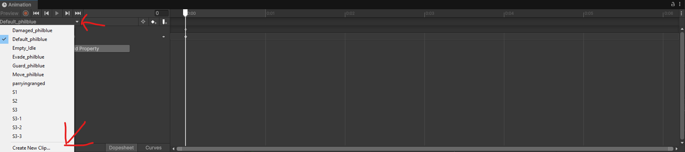

When doing your first animation clip, add the `sprite` property of the sprite renderer that is inside `SpRenderer` so the scale is correct. To use your sprites in an animation clip, select them in the assets window, change their type to `Sprite (2D and UI)`, change `Sprite Mode` to Single, and drag them into the animation clip. Set the pivot of your sprites to where the ground would be, between the legs, so in-game effects line up.

For a sprite idle, put the image sequence on a timeline and add that timeline as the first entry of `Timeline Assets` on the motion whose `motiondetail` is `Idle`. Leave `isSpineAnim` off for that motion, and keep `Sprenderer_charactermotion` pointing at the sprite renderer on `SpRenderer`. The plugin keeps that timeline playing and the sprite renderer visible. A Spine idle stays on the skeleton: mark that motion as a spine anim, and this path leaves it alone.

# Timeline making

Timelines contain the skill animations, including movement, camera, and damage markers. Wav/ogg playback is a Unity Audio Track, described above. FMOD banks use an FMOD event track, not this one.

First, right click on the assets tab and create a new timeline asset.

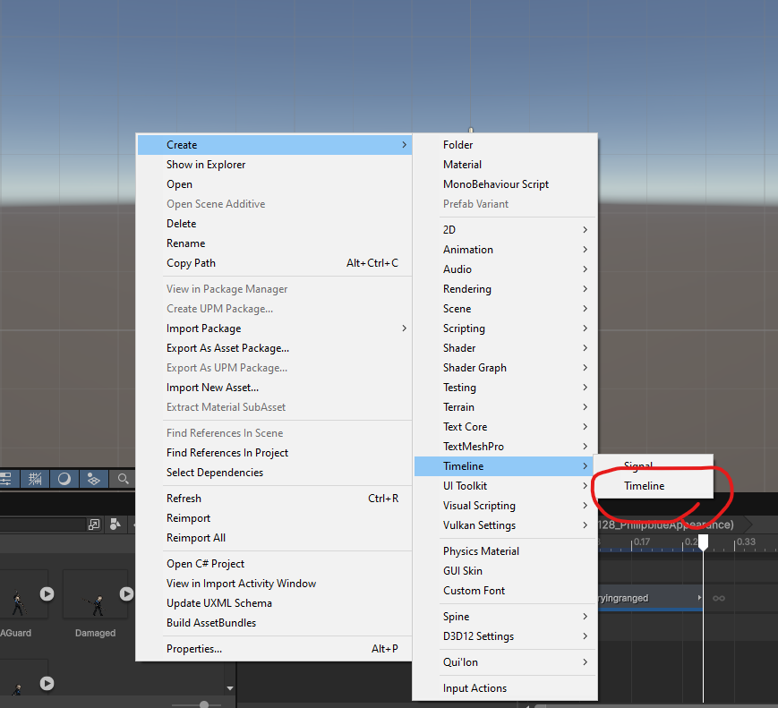

Then drag the timeline asset you are editing into the `PlayableDirector` of your appearance. Do this for any timeline you are editing so you can see the movement preview and parent the tracks.

Right click on the timeline. You will see something similar to this:

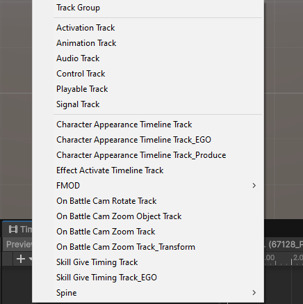

These are the track types used for motions. The ones that matter first:

- `Animation` track. Set its animator to the one on your appearance object, then drag animation clips onto this track.

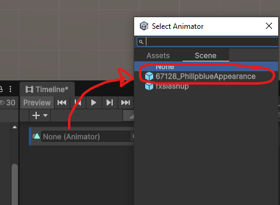

- `Character Appearance Timeline` track. Set this one to your character appearance. Right click the track and you get a long list. The markers you need first are these:

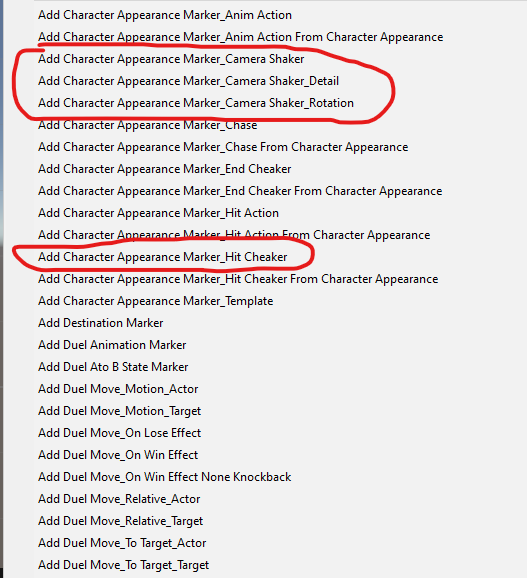

Each one adds a marker. The marker tells the game when to do that action. Most of the fields match what custom motions calls the same thing.

- `Skill Give Timing` track. Also set this to your character appearance. Right click and scroll the menu. The markers below are the ones to start with. They work like motions markers, but the values live on the timeline instead of in a json file.

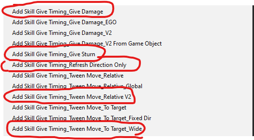

- `Effect Activate` track. Same setup. This controls VFX. Parent the VFX under `DefaultEffectPivot`, add `CharacterAttackEffect` or `CharacterAttackEffectV2`, and set `This Particle` to the particle system. Then right click the track and add it from the character attack effect list. Position and scale follow the object under `DefaultEffectPivot`.

- `On Battle Cam Zoom` and `On Battle Cam Rotate` tracks. Same setup. Right click and add a zoom or rotate clip. Duration is the length of the clip on the timeline.

# Making Motions

Build the motion on the timeline you already set up. Marker names match the motions json fields with the same name. Add a `Character Appearance Marker_Hit Cheaker` at the end of the motion. Skill motions with multiple coins should use one timeline per coin.

Check the PlayableDirector bindings, then open `Motion List` on `AbnormalityAppearnce` or `CharacterAppearance`.

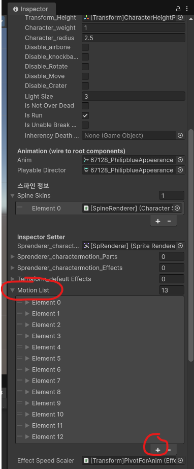

The plus button adds an element:

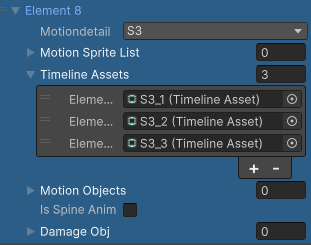

`motiondetail` is the motion, such as s1, s2, or parry. `Timeline Assets` is where the timelines go. A multi-coin skill can put each coin's timeline in that list under the same motiondetail. Variations, such as extra parry animations, use the same list. Motions that use Spine should be marked as a spine anim on that element.

For motions like guard, move, or damaged, you can skip the timeline. Open the animation controller, add a state named for that motion, and point its motion slot at your animation clip:

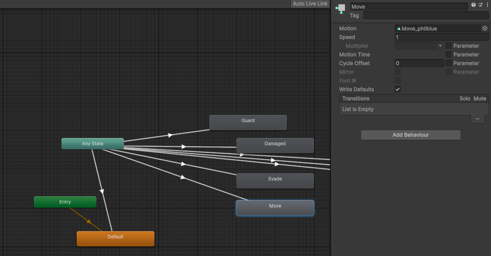

# Setting up timeline preview in unity

When using Doppel's project you can set up a preview scene in Unity for movement, knockback, and a camera preview. The camera preview is not exact.

Use `Build` > `preview` > `Setup preview sandbox in scene`:

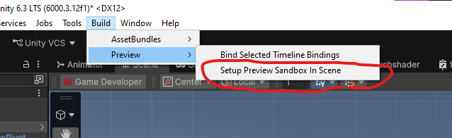

A dummy named `Preview Target (dummy)` appears in the hierarchy. That dummy is the target for move-to-target and hit knockback.

Remove any timeline from the appearance's PlayableDirector, then set the appearance position to x:0 y:0 z:0. Set `Preview Target (dummy)` to x:10 y:1 z:0. Put the timeline back on the PlayableDirector. If the bindings are wrong, use `Build` > `Bind selected timeline bindings`. If putting the timeline back moves the appearance off 0,0,0, set the position back and try again.

# Spine animations

AssetLoader can play Spine as well as sprites. PM mostly uses Spine for idles. You can use it on other motions too.

This is the idle setup used with Spine 3.8.75. It assumes the animation is already done in Spine. It is not a Spine authoring guide.

In the Spine project, press `Ctrl + E`. Export `binary` with the `.skel` extension, and set the atlas extension to `.atlas`:

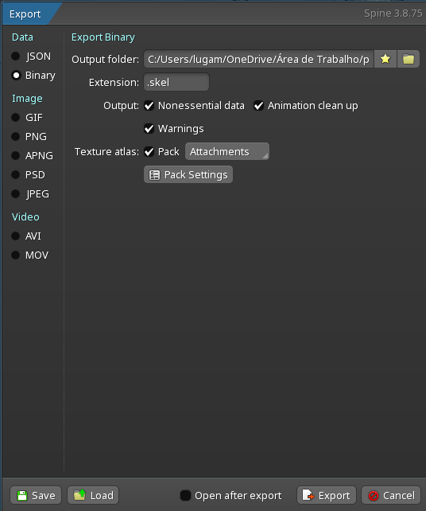
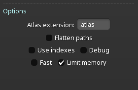

The export looks like this:

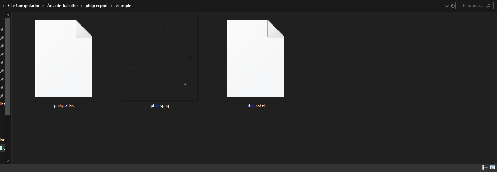

If the Spine version is not 4.0.0, convert the export to exactly 4.0.0 with [Spine Skeleton Data Converter](https://github.com/wang606/SpineSkeletonDataConverter). Convert from your exact Spine version to exactly 4.0.0.

Rename `.skel` to `.skel.bytes` and `.atlas` to `.atlas.txt`, then drag the files into Unity:

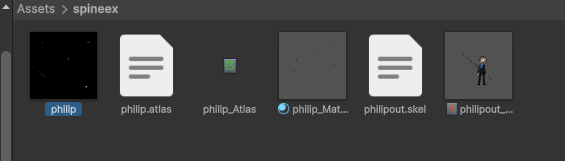

Select the `SkeletonDataAsset` and click `Create animation Reference assets`.

On `[SpineRenderer]` under `[SpinePivot]`, assign your `SkeletonDataAsset` on `SkeletonAnimation` and click reload. To match PM, set that component's sorting layer to `BattleUnit`.

For timelines, replace the sprite `Animation` track with a `SpineAnimationState` track bound to `[SpineRenderer]`. Drag the animation reference assets onto that track.

Motions that use Spine have to be marked as spine anims in the appearance `Motion List`.

# Building your bundle

Copy `exportfiles/BuildAssetBundles.cs` into the project's `Editor` folder. Build from `Build/AssetBundles/Windows64`. That menu also packs `.wav` and `.ogg` as `.bytes` for the Timeline audio path above. FMOD banks are not part of this build. They still go in `custom_banks`.

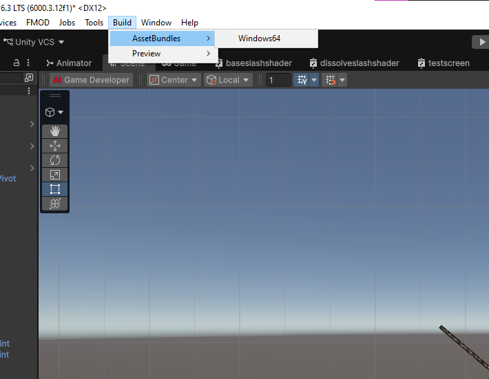

The bundle file is written here:

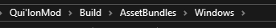

The file may not have a `.bundle` extension. Leave it that way. Load it with AssetLoader as described at the top and use it like a vanilla appearance.

Whenever you change the appearance instance in the scene, select the main object, open `Overrides`, and apply them onto the prefab that gets built.

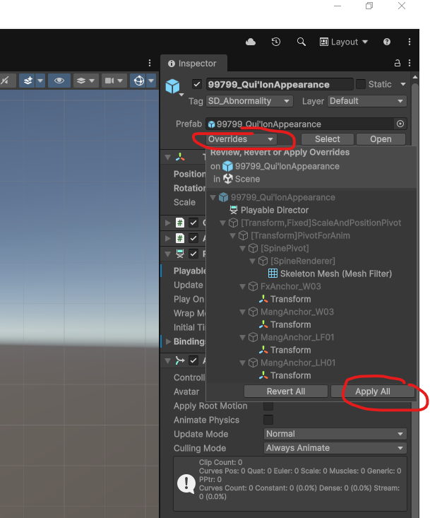
